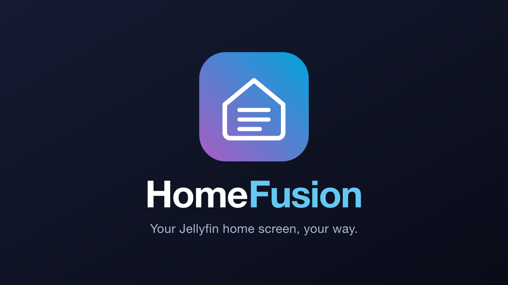

# HomeFusion

<p align="center">
	
</p>

<p align="center">
	<a href="https://github.com/MFerretti27/HomeFusion/actions/workflows/ci.yml">
		
	</a>
	<a href="https://github.com/MFerretti27/HomeFusion/releases">
		
	</a>
</p>

Jellyfin 12.4 plugin that adds four configurable card rows to the Jellyfin Web home screen:

- **Genres** – one card per genre (Action, Comedy, Romance, …), sorted by item count.
- **Ratings** – Top 50, 8–10 Stars, 7 Stars, 6 Stars, 5 Stars, … (community rating).
- **Release Date** – Latest, 2020's, 2010's, 2000's, 1990's, … 
- **Collections** – one card per collection, sorted by name, opening its Jellyfin details page (off by default).

Cards use Jellyfin's native overflow card markup: portrait cards for Collections, landscape cards for Genres, Ratings and Release Date. Collection cards prefer poster artwork, falling back to other collection artwork when no poster exists. Clicking a genre, rating or release date card opens a grid of the matching titles; collection cards open Jellyfin's collection details page.

Cards across all enabled HomeFusion rows coordinate artwork selection to maximize unique images, preferring backdrops from matching titles (or the collection's own artwork). When distinct artwork runs out, images can repeat; folder placeholders are only used when a card has no artwork available.

## Install

Add this repository URL under **Dashboard → Plugins → Repositories**:

```
https://github.com/MFerretti27/HomeFusion/releases/latest/download/manifest.json
```

Install **HomeFusion** from the catalog and restart Jellyfin. The client script is injected into the web client's `index.html` response automatically (no file writes needed).

## Screenshots
<p align="center">

</p>


## Settings

Open **Dashboard → Home Fusion** (sidebar shortcut under Plugins). For each row you can:

- enable or disable it, and
- choose where it appears: top of Home, after My Media / Continue Watching / Latest Media / Next Up / Continue Listening / Continue Reading / Live TV / Active Recordings, or bottom of Home.

You can also hide specific genres (e.g. Documentary or TV Movie) from the Genres row, randomize the order of the genre cards (shuffled on each Home load), include movies and/or series.

Enable the Collections row to show the current user's collections, independently of the movie/series filters. Its settings include a row position, an option to randomize collection order each time Home loads, and a maximum number of collections on Home (0 means unlimited). The View all button always shows every collection.

The Content settings can also hide title counts on cards across all four HomeFusion rows, including the collections grid. Counts are shown by default.

Rows sharing a position appear in this order: Collections, Genres, Ratings, Release Date.

**Interface tweaks** (all off by default): hide the SyncPlay button, hide the Cast / Play On button, round poster and card corners, hide the "My Media" section title or card labels, and hide standalone movie years on Jellyfin cards and movie years in HomeFusion grids without hiding TV show details.

## Development

```sh
npm ci
npm run build:plugin            # tests + versioned ZIP + manifest preview in artifacts/
dotnet test tests/HomeFusion.Tests/HomeFusion.Tests.csproj
```

## Releasing

Push a `vX.Y.Z` tag, or run the **Publish Jellyfin plugin** workflow manually (optionally with a version; otherwise the patch version is bumped). The workflow tests, builds `HomeFusion_X.Y.Z.zip`, generates `manifest.json` and publishes a GitHub release. The manifest includes all published stable releases, using each release's existing manifest and ZIP; it fails if either asset or its version metadata is missing. Drafts and prereleases are excluded. Existing release assets are not changed, so catalog updates appear after the next release is published. The local build produces a single-version manifest preview.
